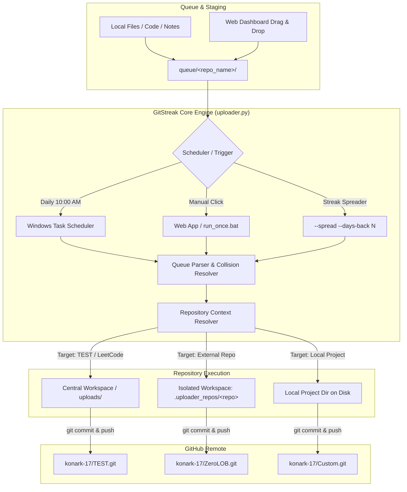

# ⚡ GitStreak — Automated GitHub Commit Engine & Multi-Repo Dashboard

<div align="center">

[](https://python.org)
[](https://fastapi.tiangolo.com)
[](https://tailwindcss.com)
[](https://microsoft.com/windows)
[](https://git-scm.com)
[](https://opensource.org/licenses/MIT)

**An intelligent, multi-repository automated GitHub file uploader and streak pacing system with a modern FastAPI web dashboard and headless Windows Task Scheduler integration.**

[Key Features](#-key-features) • [Quick Start](#-quick-start) • [Web Dashboard](#-web-dashboard) • [Architecture](#-architecture) • [CLI Commands](#-cli-commands) • [REST API](#-rest-api-reference)

</div>

---

## 📖 Overview

Maintaining a consistent GitHub commit graph requires daily discipline. **GitStreak** automates this by systematically uploading your queued files, solutions, and code notes one by one into your target GitHub repositories.

Whether you are pacing your daily LeetCode solutions, syncing project modules, backdating a streak across past days, or routing uploads across 10+ different repositories, GitStreak provides a full-featured visual dashboard and a headless background daemon that runs silently on Windows.

---

## 🌟 Key Features

### 1. 🗂️ First-Class Multi-Repo Routing & Compulsory Target Selection
- Manage multiple independent repository profiles (`leetcode`, `ZeroLOB`, `RoutePulse`, `TEST`, etc.).
- **Compulsory Selection**: No ambiguous "default" fallback; every file uploaded must be explicitly targeted to prevent accidental commits.
- **Isolated Workspaces**: External repositories with their own remotes are isolated in dedicated directories (`.uploader_repos/<repo_name>`), ensuring your main repository is never cross-polluted.

### 2. 🌐 Modern FastAPI Web Dashboard
- **Glassmorphism UI**: Built with TailwindCSS and Lucide Icons with dark mode styling.
- **Interactive Heatmap**: 60-day GitHub-style contribution matrix with hover details and commit metrics.
- **Drag & Drop Upload Zone**: Drop code files directly into the browser to queue them for any repository.
- **Queue Explorer**: Preview file contents, inspect sizes, and remove queued items in real time.
- **Real-Time Log Stream**: Live terminal logs streamed directly to the browser via SSE / poll.

### 3. 🔥 Intelligent Streak Spreader (`--spread`)
- Spreads queued files across past dates (1 commit per day) using Git's native `GIT_AUTHOR_DATE` and `GIT_COMMITTER_DATE`.
- Perfect for populating historical contribution squares with authentic, single-file commits.

### 4. ⏰ Headless Windows Daily Automation
- Native **Windows Task Scheduler** integration via PowerShell.
- Runs completely in the background once per day (e.g. at 10:00 AM) without needing a terminal or browser window open.
- Manage scheduling directly from the Web UI or via `setup_scheduler.bat`.

### 5. 🔄 1-Click GitHub Account Sync
- Automatically imports all public repositories from your GitHub account (`konark-17`) into your config.
- Scans sibling folders on disk to detect local Git projects and links them with a single click.
- Two-way GitHub sync center: inspect unpushed/unpulled commit divergence, pull updates, or force sync.

---

## 🏗️ Architecture



---

## 🚀 Quick Start

### Prerequisites
- Windows 10 or 11
- Python 3.10+
- Git installed and configured with your GitHub credentials

### Installation

1. **Clone or Download this repository**:
   ```powershell
   git clone https://github.com/konark-17/GitStreak.git
   cd GitStreak
   ```

2. **Install Python dependencies**:
   ```powershell
   pip install fastapi uvicorn requests python-multipart
   ```

3. **Launch the Visual Web Dashboard**:
   Double-click **`start_web_app.bat`** (or run `python web_app.py`).  
   Your default browser will automatically open to:  
   👉 **`http://localhost:8000`**

---

## 🖥️ Web Dashboard

The web application runs locally and exposes full control over the engine:

| Dashboard Card | Functionality |
|---|---|
| **Contribution Heatmap** | 60-day matrix displaying all local and pushed commits with date tooltips |
| **Dropzone** | Drag & drop files directly into any target repository profile |
| **Queue Table** | Real-time queue inspector with filter-by-repo and code preview popup |
| **Streak Spreader** | Slider to choose file count and days to span commits across |
| **Task Scheduler** | 1-click install, uninstall, or time-change for Windows daily background task |
| **Repo Center** | Add custom Git remotes, sync account repos, or link local directories |
| **Sync Center** | Check ahead/behind divergence against GitHub and trigger push/pull |

---

## ⏰ Windows Background Automation

Run headless daily commits without opening any software:

- **Via Web Dashboard**: Open `http://localhost:8000`, set your daily time (default: `10:00`), and click **Install Schedule**.
- **Via Batch Script**: Double-click **`setup_scheduler.bat`** and choose:
  - `1`: Install Daily Schedule (10:00 AM)
  - `2`: Install with Custom Time (e.g., `09:30` or `19:00`)
  - `3`: Check Status
  - `4`: Test Run Task Now
  - `5`: Remove Task

Activity is logged to `logs/uploader.log`.

---

## 💻 CLI Commands

| Command | Action |
|---|---|
| `python uploader.py` | Upload next 1 file from queue right now |
| `python uploader.py --repo <name>` | Upload next file targeting a specific repository profile |
| `python uploader.py --status` | View queue breakdown per repo, history, and configured remotes |
| `python uploader.py --count 5` | Upload 5 files sequentially with 5 separate commits |
| `python uploader.py --repo <name> --count 10 --spread --days-back 10` | Backdate 10 commits across the past 10 days |
| `python uploader.py --dry-run` | Preview what file would be committed without making changes |
| `python uploader.py --sync-all-github` | Fetch and register all public repositories from GitHub |
| `python uploader.py --setup` | Interactive command-line setup wizard |

---

## 🔌 REST API Reference

The FastAPI backend exposes endpoints for automation and external scripts:

| Method | Endpoint | Description |
|---|---|---|
| `GET` | `/api/status` | Comprehensive status of queue, config, history, and scheduler |
| `POST` | `/api/upload-single` | Trigger single file upload (`{ "repo": "name", "dry_run": false }`) |
| `POST` | `/api/upload-batch` | Trigger batch / streak upload with backdating |
| `POST` | `/api/queue/upload` | Multipart form upload of files into a repository queue |
| `GET` | `/api/queue/preview/{path}` | Preview text content of any queued file |
| `DELETE` | `/api/queue/{path}` | Delete a file from the queue |
| `GET` | `/api/repos/local-detected`| Auto-detect local Git project folders on machine |
| `POST` | `/api/github/sync-all-repos`| Import all repositories from GitHub account |
| `GET` | `/api/sync/status` | Check commit divergence (`ahead` / `behind`) for target repo |
| `POST` | `/api/sync` | Execute `push`, `pull`, or two-way `sync` |
| `GET` | `/api/logs` | Fetch real-time tail of `uploader.log` |

---

## 📁 Repository Structure

```text
GitStreak/
├── queue/                   # Drop files here (organized by subfolder: queue/<repo>/)
├── uploads/                 # Target folder for local repository uploads
├── logs/                    # Background scheduler execution logs
├── web/
│   ├── static/              # Frontend CSS & JavaScript (app.js)
│   └── templates/           # Dashboard HTML template (index.html)
├── config.json              # Repository profiles & author settings
├── uploader.py              # Main Git commit & scheduling engine
├── web_app.py               # FastAPI backend server
├── run_once.bat             # 1-click launcher: Upload 1 file now
├── start_web_app.bat        # 1-click launcher: Open Visual Dashboard
├── status.bat               # 1-click launcher: View CLI status
├── sync_all_repos.bat       # 1-click launcher: Sync all GitHub account repos
├── setup_scheduler.bat      # Windows Task Scheduler manager menu
├── setup_scheduler.ps1      # PowerShell backend for Task Scheduler
├── publish_to_github.bat    # 1-click launcher: Publish GitStreak to GitHub
├── upload_history.json      # Persistent log of all committed files & hashes
├── test_uploader.py         # Test suite for uploader engine
└── test_web_app.py          # Test suite for FastAPI endpoints
```

---

## 🧪 Testing

Comprehensive unit and integration test suites are included:

```powershell
# Run core uploader engine tests (7 tests)
python test_uploader.py

# Run FastAPI web app and API tests (9 tests)
python test_web_app.py
```

Both test suites run in isolated temporary sandboxes without modifying your local repository.

---

## 👤 Author

**Konark**
- GitHub: [@konark-17](https://github.com/konark-17)
- Email: [kona300107@gmail.com](mailto:kona300107@gmail.com)

---

## 📄 License

This project is licensed under the [MIT License](LICENSE).
